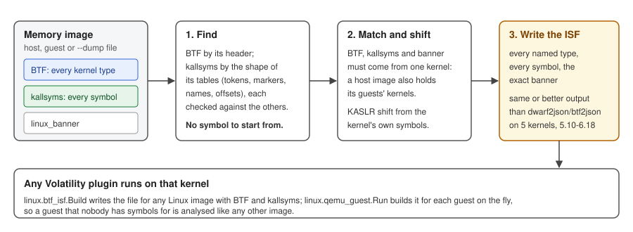

# Hidden VMs: QEMU, KVM and Firecracker guests in host memory for Volatility 3

On the host, each VM is a single process, the VMM (QEMU, Firecracker), and that process is often renamed. The guest's
RAM is memory of that process, so a memory image of the host holds the whole guest, but Volatility 3 sees only the
process. These eight Volatility 3 plugins find each guest in a Linux or Windows host image, even when the VMM is renamed
or, on a Linux host, unlinked from the task list. They show who started each guest and how it is reached and controlled,
and run any Volatility plugin inside it:

| Plugin | Answers |
|---|---|
| `linux.qemu.VMs`, `windows.qemu.VMs` | Which QEMU VMs run on the host, even renamed? Who started them, how are they reached and controlled? |
| `linux.qemu_guest.Run`, `windows.qemu_guest.Run` | What runs inside a guest? Runs any Volatility plugin on it in place; a Linux guest with BTF and kallsyms needs no symbol file. |
| `linux.kvm.VMs`, `linux.kvm.Slots`, `linux.kvm.VCPUs` | Every KVM VM of any VMM, even with a hidden owner; its memory map and vCPU registers. |
| `linux.btf_isf.Build` | A symbol file (ISF) for a kernel that has none, built from the image itself. |

Terms are defined in [Terms](#terms).

## Setup
You need Python 3.8 or later and Volatility 3 2.28.2 or `develop`, for example
`python3 -m venv .venv && .venv/bin/pip install volatility3==2.28.2`. Hosts and guests must be x86-64 PCs.
Volatility 3 (2.28.2 and `develop`) reads only 4-level page tables, so it cannot analyse a host or guest kernel that
runs with 5-level paging (LA57). Linux uses 5-level paging on CPUs that support it (Intel Ice Lake and later, AMD Zen 4
and later) unless booted with `no5lvl`.

1. **Plugins.** Clone this repository
   (`git clone https://github.com/miqsoft/volatility3-hidden-vms && cd volatility3-hidden-vms`) and use its `plugins/`
   in place with `-p plugins`, or copy it unchanged into a plugin folder. The plugins are in `plugins/linux/` and
   `plugins/windows/`; they import the helper modules `qemu_common.py`, `qemu_cmdline.py`, `qemu_acpi.py`,
   `qemu_guest_run.py`, `kernel_btf.py` and `kallsyms_scan.py` from the top of the folder.
2. **Host symbols.** A Linux host needs the ISF of its kernel in a folder of its own, made with dwarf2json from the
   kernel's debug package, or from the image with `linux.btf_isf.Build` if the kernel has BTF and kallsyms (the default
   in current distributions). A host image also holds its guests' kernels, so name the host's with `--release`
   (`vol -f host.raw banners.Banners` lists the kernels in an image):
   ```
   mkdir -p symbols-host/linux
   vol -o symbols-host/linux -p plugins -f host.raw linux.btf_isf.Build --release 6.1.0-54-cloud-amd64
   ```
   For a Windows host, Volatility downloads the PDB. The `linux.kvm` plugins need no extra file: they read the KVM
   module's types from the module BTF in the image (`CONFIG_DEBUG_INFO_BTF_MODULES`; without it they print no rows).
3. **Guest symbols.** A Linux guest with BTF and kallsyms (`CONFIG_DEBUG_INFO_BTF`, `CONFIG_KALLSYMS_ALL`) needs
   nothing: `Run` builds the ISF from the guest's memory. A Windows guest uses the PDB its banner names, as for any
   Windows image. For any other guest, make the ISF first; `docs/guest-symbols.md` shows how (debug package,
   btf2json, and a rebuild for Tiny Core).

Keep host and guest ISFs in separate folders: a host image also holds the guest kernels, and if a guest ISF is in
`-s`, Volatility may pick the guest kernel for the host. Pass guest ISFs to `Run` with `--guest-symbol-dirs`. The
plugins warn when they find no host processes.

## Usage
Run Volatility 3 (`vol`) with the folders from [Setup](#setup):
```
vol -s SYMBOLS -p plugins -f IMAGE linux.qemu.VMs
vol -s SYMBOLS -p plugins -f IMAGE linux.qemu_guest.Run --pid PID --guest-plugin linux.pslist.PsList
vol -s SYMBOLS -p plugins -f IMAGE linux.kvm.VMs
```
`SYMBOLS` is the folder with the host ISF, `plugins` the folder from step 1, `IMAGE` the host image. `VMs` lists the
guests with the PID of each VMM; `Run` runs a plugin inside the guest of that PID. On a Windows host use
`windows.qemu.VMs` and `windows.qemu_guest.Run` the same way. Name plugins in full (`linux.qemu.VMs`): Volatility 3
matches names by substring.

Example output of `linux.qemu.VMs` on the test host `hv1` (9 of 26 columns):
```
PID     COMM            Accel  vCPUs  Machine  RAM MiB  Resident %  Firmware  Guest banner
950     kdevtmpfsi      TCG    -      pc       128      98.4        BIOS      Linux version 6.18.58-0-virt (buildozer@build-3-24-x86_64) ...
979     fwupd-refresh   KVM    1      q35      128      98.4        BIOS      Linux version 6.18.58-0-virt (buildozer@build-3-24-x86_64) ...
1035    polkitd-helper  KVM    1      q35      128      99.9        BIOS      Linux version 6.18.58-0-virt (buildozer@build-3-24-x86_64) ...
* 1035  polkitd-helper  -      -      -        64       -           -         -
* 1035  polkitd-helper  -      -      -        64       -           -         -
1099    irqbalanced     KVM    2      -        -        -           -         -
1315    tracker-miner   KVM    1      q35      256      100.0       UEFI      Linux version 6.18.58-0-virt (buildozer@build-3-24-x86_64) ...
1398    colord-sync     KVM    2      q35      2048     100.0       BIOS      Windows kernel ntkrnlmp.pdb B65A1E5D9D57D828E82F8C75F19E9857-1
```
Every process is a renamed VMM. `950` runs under QEMU's software emulator (TCG), so no KVM file points to it. `1035`
has two RAM blocks (child rows `*`). `1099` is Firecracker: it has a KVM file but no ACPI, so it is listed without RAM;
`linux.kvm.VMs` reads it. Firecracker `1209` is missing: its process is hidden from the task list, and only
`linux.kvm.VMs` finds it. Every column is explained in [Plugins](#plugins).

### Which plugin when
| Question | Plugin |
|---|---|
| Does a Linux host run QEMU VMs, even renamed? Who started them, when, from which file? Ports, networks, control sockets, disks, RAM? | `linux.qemu.VMs` |
| The same on a Windows host (QEMU for Windows, CRON#TRAP) | `windows.qemu.VMs` |
| The VMM is not QEMU (Firecracker, cloud-hypervisor, crosvm), has no ACPI, or is hidden from the task list | `linux.kvm.VMs` |
| What is the exact guest-physical memory map of a KVM guest? | `linux.kvm.Slots` |
| What were the guest's vCPUs doing (RIP, CR3, last exit)? | `linux.kvm.VCPUs` |
| What runs inside the guest? | `linux.qemu_guest.Run` (`--kvm` for the KVM path), `windows.qemu_guest.Run` on a Windows host |
| I want the guest as a file | `--dump` on any `VMs` plugin |
| A kernel image has no ISF | `linux.btf_isf.Build` |

### How guests are found
- **QEMU path** (`linux.qemu.VMs`, `windows.qemu.VMs`): the plugin looks into every process for a memory block that
  holds a PC guest's low RAM. It recognises it by the ACPI table (the RSDP) that the guest's firmware leaves there. This
  works on any host CPU, with KVM and with TCG, on Linux and Windows hosts. A microVM without ACPI is listed from its
  KVM file but not rebuilt. A UEFI guest is found only in a process that counts as a VMM (a KVM file, two QEMU-only
  options, or QEMU's libraries mapped); if its RSDP is not found, for example because the page is paged out, it is
  listed from its command line, with a warning.
- **KVM path** (`linux.kvm.*`): the plugin follows the host kernel's own KVM structures, one per VM. This gives the
  exact memory map and the vCPUs for any VMM, finds a VMM that is hidden from the task list, and needs no ACPI. It needs
  a Linux host with KVM and module BTF. A VM that is neither on KVM's `vm_list` nor held by any process's file is not
  found.

Start with the QEMU path. Use the KVM path for Firecracker and other VMMs, for a hidden VMM, and for the vCPU
registers.

## Plugins
Each plugin below has the same parts: what it shows, an example (real output, columns trimmed) and how to read it. All
plugins except `linux.btf_isf.Build` take `--pid PID ...` to select VMM processes; the `VMs` plugins take `--dump`.
Most examples are from the test host `hv1`; those from `n2`, `w3` and `r1` show cases that `hv1` lacks.

### `linux.qemu.VMs`: which QEMU VMs run on a Linux host
One row per QEMU process, and one per other process with a KVM file whose guest has no ACPI tables (Firecracker); such a
VMM is listed without RAM and read with `linux.kvm.VMs`.
- The process: PID, COMM, parent, UID, start time, executable (a deleted binary keeps the kernel's ` (deleted)`),
  accelerator (KVM or TCG), vCPUs.
- From the command line: VM name, Proxmox VM ID, port forwards, `Network` (user, tap, bridge, socket, ...), `Control`
  (monitor, QMP, serial ports, gdb stub, guest agent, VNC and SPICE, each with its endpoint and `listen` or `connect`),
  disk and kernel images, machine type.
- The RAM (size, address, blocks, backing, resident %), the firmware (BIOS or UEFI), `Encrypted` for confidential
  guests, the guest banner. A guest with several RAM blocks (NUMA nodes, DIMMs) gets one child row (`*`) per block.
- `--dump` writes `vm.<pid>.<addr>.elf` to the `-o` folder (p_paddr is the guest-physical address); the `File output`
  column names it. Missing pages are written as zeros ([Missing pages](#missing-pages)).

A Proxmox host with two VMs. VM 101 has NUMA, memory hotplug and OVMF:
```
$ vol -s symbols-pve -p plugins -f n2.host.elf linux.qemu.VMs
PID     COMM  vCPUs  Name       VMID  Machine  RAM MiB  RAM at          RAM blocks  Backing    Resident %  Firmware  ACPI OEM  RSDP at
1150    kvm   1      plain      100   q35      1024     0x74febbe00000  1           anonymous  63.5        BIOS      BOCHS     0xf5290
1170    kvm   2      hotplug    101   q35      2048     0x7a29b3e00000  4           anonymous  46.2        UEFI      BOCHS     0x3bf77000
* 1170  kvm   -      ram-node0  -     -        512      0x7a29b3e00000  -           anonymous  -           -         -         -
* 1170  kvm   -      ram-node1  -     -        512      0x7a2993c00000  -           anonymous  -           -         -         -
  ... (two more child rows: mem-dimm0 and mem-dimm1)
```
Notes:
- Confidential guests (SEV, SEV-ES, SEV-SNP, TDX) cannot be recovered from the host. `Encrypted` names the kind and
  the dump is skipped. Not tested on real SEV or TDX hardware.
- DIMMs added at run time (QMP `device_add`) and virtio-mem memory are not placed by the QEMU path. A warning names them
  and points to `linux.kvm.VMs` and `linux.kvm.Slots`, which place them from the memslots.
- On q35 the guest RAM includes the SMM TSEG (the top 16 MiB of low RAM, 64 MiB on machine types from QEMU 10.2) at its
  own addresses. The guest OS never uses it and the firmware reserves it.
- `Started` is `-` for host kernels 6.17 and later with Volatility 3 2.28.2, which cannot read their boot time.
- The listing reads every guest's banner and residency, so it takes time on a big image (about 30 s for the 4.8 GB
  `hv1`). Use `--pid` to narrow it.

### `windows.qemu.VMs`: the same on a Windows host
The same for QEMU for Windows (RAM from VirtualAlloc, command line from the PEB). The process columns are PID, process
name, parent, start time and executable. Below is the CRON#TRAP case: QEMU renamed `fontdiag.exe`, TCG, SSH forwarded.
The monitor and the serial console listen on TCP, so whoever reaches 127.0.0.1:4445 controls the VM:
```
$ vol -p plugins -f w3.host.elf windows.qemu.VMs --dump
PID   Process       PPID  Started              Executable                                     Accel  Forwards                Network  Control                                                                  Machine  RAM MiB  Guest banner                  File output
4000  fontdiag.exe  1224  2026-11-04 17:32:46  C:\ProgramData\Microsoft\DiagSvc\fontdiag.exe  TCG    tcp:127.0.0.1:2222-:22  user     monitor tcp:127.0.0.1:4445 (listen), serial tcp:127.0.0.1:4444 (listen)  q35      256      Linux version 6.18.58-0-virt  vm.4000.0x22c65220000.elf
```
A VMM whose command line names no QEMU option (QEMU started with `-readconfig` only) is recognised by the QEMU DLLs it
loads. Windows command lines are split on blanks and double quotes; `\"` escapes are not handled.

### `linux.qemu_guest.Run`: run a plugin inside the guest
Runs a guest plugin on the guest in place. No file is written. Options:
- `--guest-plugin NAME`: the plugin to run on the guest, for example `linux.pslist.PsList`. A short name such as
  `linux.pslist` works when it is unique.
- `--pid PID`: the VMM process. It is needed if the image holds several guests. `--ram-at ADDR`: the guest's `RAM at`
  from `linux.qemu.VMs`, if one process holds several guests.
- `--kvm`: find the guest through `linux.kvm` instead of the QEMU process: any VMM, exact memory map.
- `--guest-symbol-dirs DIR [DIR ...]`: folders with the guest kernel's ISF, separated by spaces. A Linux guest with
  BTF and kallsyms needs none.
- `--save-guest-symbols`: if `Run` had to build the ISF, it writes `<release>.json.xz` to the `-o` folder.
- Options of the guest plugin are set with Volatility's `-e plugins.Run.<PluginClass>.<option>=<JSON>`, which goes
  before `linux.qemu_guest.Run`. Example: `-e 'plugins.Run.PsList.pid=[1]'`.

A wrong call (no guest, several guests, unknown or missing `--guest-plugin`) prints one `ERROR` line that says what to
select, and an empty table. Missing guest symbols stop `Run` with a message. A Linux guest under a renamed QEMU on
`hv1`; `Run` builds the guest's ISF from its memory (about 7 s):
```
$ vol -s symbols-host -p plugins -f hv1.host.elf linux.qemu_guest.Run --pid 979 --guest-plugin linux.pslist.PsList
OFFSET (V)      PID   TID   PPID  COMM
0x99a0c1170000  1     1     0     init
...
0x99a0c2449f80  1802  1802  1     login
0x99a0c2f13f00  1804  1804  1802  sh
0x99a0c2f15e80  1806  1806  1804  nc
```
A Windows guest on the same host; the folder `symbols` holds its kernel ISF:
```
$ vol -s symbols-host -p plugins -f hv1.host.elf linux.qemu_guest.Run --pid 1398 --guest-symbol-dirs symbols \
      --guest-plugin windows.cmdline.CmdLine
PID   Process         Args
...
3748  powershell.exe  powershell.exe -NoProfile -ExecutionPolicy Bypass -WindowStyle Hidden -File C:\ProgramData\WinSvc\listen.ps1 canary-hv1-listener
```
A Firecracker VM whose process is unlinked from the task list needs `--kvm`:
```
$ vol -s symbols-host -p plugins -f hv1.host.elf linux.qemu_guest.Run --kvm --pid 1209 --guest-plugin linux.pslist.PsList
OFFSET (V)      PID   TID   PPID  COMM
...
0x8880045c4180  1662  1662  1655  sh
0x888005fea0c0  1664  1664  1662  nc
```
To keep the guest as a file instead, write it with `--dump` and open it like any image:
```
mkdir -p out isf/linux
vol -o out -s symbols-host -p plugins -f hv1.host.elf linux.qemu.VMs --pid 979 --dump
vol -o isf/linux -p plugins -f out/vm.979.0x7f63a3e00000.elf linux.btf_isf.Build
vol -s isf -f out/vm.979.0x7f63a3e00000.elf linux.pslist.PsList
```

### `windows.qemu_guest.Run`: the same on a Windows host
The guest is found by `windows.qemu.VMs`. It has no `--kvm`.

### `linux.kvm.VMs`: every KVM VM, even with a hidden owner
One row per KVM VM: address, owner PID and process data (`-` for a hidden owner), vCPUs, memslots, RAM MiB, SMRAM KiB,
resident %, `Encrypted`, guest banner. Three columns show how the VM was found: `On vm_list` (KVM's global list),
`kvm-vm file` (a process holds a file for it) and `Owner listed` (the owner is in the task list). A `False` in any of
them is worth a look; `Owner listed` = `False` is a hidden VMM. `--dump` writes `kvm.<pid>.<kvm addr>.elf`, one
segment per memslot. With `--dump`, `--smm` also writes the SMM address space. The hidden Firecracker VM of `hv1`:
```
$ vol -s symbols-host -p plugins -f hv1.host.elf linux.kvm.VMs
KVM                 PID   COMM  On vm_list  kvm-vm file  Owner listed  vCPUs  RAM MiB  Guest banner
0xffffcc3340f41000  1209  -     True        False        False         1      112      Linux version 6.18.58-0-virt ...
```
A QEMU renamed `fwupd-refresh` on a Proxmox host with AMD hardware, with the SMM file:
```
$ vol -s symbols-r1 -p plugins -f r1.host.elf linux.kvm.VMs --dump --smm
KVM                 PID   COMM           On vm_list  kvm-vm file  Owner listed  vCPUs  Slots  RAM MiB  SMRAM KiB  Resident %  Guest banner                    File output                      SMM file output
0xffffc96d03975000  5066  fwupd-refresh  True        True         True          1      19     271      128        53.7        Linux version 6.18.58-0-virt..  kvm.5066.0xffffc96d03975000.elf  kvm.5066.0xffffc96d03975000.smm.elf
```
`RAM MiB` (271) includes 16 MiB of VGA RAM, which KVM sees as RAM.

### `linux.kvm.Slots`: the guest-physical memory map
One row per memslot: address space (0 normal, 1 SMM), slot id, guest-physical range, host address in the VMM,
`Read-only`, `Dirty log`, `KVM internal`, backing, resident pages.
```
$ vol -s symbols-r1 -p plugins -f r1.host.elf linux.kvm.Slots
PID   Space  Slot  GPA         Size       Host VA         Read-only  Dirty log  KVM internal  Backing    Pages  Resident pages
5066  0      0     0x0         0xa0000    0x7f0bd3e00000  False      False      False         anonymous  160    160
5066  0      8     0x100000    0xff00000  0x7f0bd3f00000  False      False      False         anonymous  65280  36096
5066  0      1     0xfffc0000  0x40000    0x7f0bf1800000  True       False      False         anonymous  64     64
```

### `linux.kvm.VCPUs`: what the vCPUs were doing
One row per vCPU: thread ID, mode, RIP, RSP, CR3, CR0, CR4, EFER, CPL, CS, last exit code and reason, `Source` of the
values and `Not current` (values that may be stale, Intel only). On AMD the values come from the VMCB and are exact as
of the last VM exit.
```
$ vol -s symbols-r1 -p plugins -f r1.host.elf linux.kvm.VCPUs
PID   vCPU  TID   Mode           RIP                 RSP                 CR3        CR0         CR4    EFER    CPL  CS    Exit code  Exit reason  Source  Not current
5066  0     5072  outside guest  0xffffffffb7e4630e  0xffffffffb8a03e70  0x3bdc000  0x80050033  0x6b0  0x1d01  0    0x10  0x78       HLT          VMCB
```

### `linux.btf_isf.Build`: an ISF from the image itself
Writes an ISF for the kernel of any Linux x86-64 image from the image itself (BTF and kallsyms): `<release>.json.xz`
in the `-o` folder, and one row. `--release` picks the kernel if the image holds several. Use the file with `-s`, like
one from dwarf2json. It needs a kernel with `CONFIG_DEBUG_INFO_BTF` and `CONFIG_KALLSYMS_ALL`, as most current
distribution kernels have. How it works: the plugin finds the kernel's BTF (its type information) and the kallsyms
tables (its symbol addresses) in the image without any symbol to start from, recognising kallsyms by the shape of its
tables. It works out the KASLR shift and writes every named type and every kallsyms symbol. Details, limits and the
manual alternatives (debug package, btf2json, Tiny Core): `docs/guest-symbols.md`.



```
$ vol -o isf/linux -p plugins -f out/vm.979.0x7f63a3e00000.elf linux.btf_isf.Build
File                    Banner                                                  Types  Symbols  BTF at     kallsyms symbols  KASLR shift
6.18.58-0-virt.json.xz  Linux version 6.18.58-0-virt (buildozer@build-3-24-...  9703   141272   0x5565000  148371            0x20000000
```

### Guest files from the page cache
The plugins do not read disks, but a memory image holds what the guest and the host cached of them. List and write the
guest's cached files with Volatility's page-cache plugins, through `Run`:
```
vol -s symbols-host -p plugins -f host.elf linux.qemu_guest.Run --pid <PID> --guest-plugin linux.pagecache.Files
vol -s symbols-host -p plugins -o out -f host.elf -e plugins.Run.InodePages.inode=<InodeAddr in decimal> \
    -e plugins.Run.InodePages.dump=true linux.qemu_guest.Run --pid <PID> --guest-plugin linux.pagecache.InodePages
```
The host's own page cache of the VM's disk image works the same way without `Run` (`linux.pagecache.Files`,
`linux.pagecache.InodePages --inode <InodeAddr> --dump`). It is empty if the VMM opens the disk with `cache=none`, the
Proxmox default. Only cached pages come back, and Volatility 3 skips large-folio entries (bug table below). On a test
guest the 23 MB `modloop-virt` came back byte for byte. A page-cache plugin on a 6.16 or later guest needs Volatility
`develop`.

### Missing pages
`Resident %` is the share of the guest's pages that the host image holds. For each VM the plugins log one warning that
says why the others are missing. `Run` logs it too:
```
WARNING volatility3.plugins.qemu_common: PID 4000: 29465 of 65536 guest pages (45.0 %) are not in the image: demand-zero 29465
```
- Linux host: `never present`, `swapped out` (Volatility has no Linux swap layer), `page table not in the image`,
  `frame not in the image`, `not present (migration, poison or marker entry)`. `read from the page cache` counts pages
  that a memfd or hugetlbfs backend still had in its page cache.
- Windows host: `demand-zero`, `pagefile N`, `compressed store`, `transition (frame not in the image)`, `prototype`,
  `page table paged out`.

What the guest plugins see: a page the guest never touched reads as zeros. A page the host swapped out, or has no frame
for, is invalid, so a plugin skips it instead of reading zeros. If the guest's RAM is backed by a file (memfd,
hugetlbfs), a page that is not in the page cache reads as zeros in two cases: hugetlbfs, and tmpfs or memfd with nothing
swapped out (`shmem_inode_info.swapped` is 0). In every other case the page is invalid, because its data may be in swap
or on disk. The `--dump` ELF writes zeros for all missing pages. An image taken from a running host also smears: 0.02 %
of the pages with AVML and 0.5 % with WinPmem in the measured runs.

On a Windows host, pass copies of the paging files with Volatility's `--single-swap-locations`, in paging-file-number
order (`pagefile.sys` is number 0). The option takes several values, so put it before `-f`, or it takes the plugin name
as a value:
```
vol -p plugins --single-swap-locations pagefile.sys -f host.raw windows.qemu.VMs --dump
```
On Windows 10 and later, Volatility 3 reads the paging file number from the wrong bits; see the bug table below.

## Volatility issues and how the plugins handle them
Seven issues of Volatility 3 affect these cases: four bugs (#2082, #2084, #2097, #2080), two kernel or Windows versions
that 2.28.2 does not support yet (#1943, #2064), and an error reason that is lost (#2088). The plugins work on the
released 2.28.2 thanks to the workarounds below. Each one is local to the plugins and will be removed once its fix is
released. "Ours" means the issue or pull request is from the author of these plugins. The pull requests listed are open.

| Issue | Upstream | Effect | What the plugins do |
|---|---|---|---|
| SysV shared memory segment 0 crashes the VMA walk | issue [#2082](https://github.com/volatilityfoundation/volatility3/issues/2082), fix proposed in PR [#2083](https://github.com/volatilityfoundation/volatility3/pull/2083) (ours) | a walk of a process's memory regions crashes on a process with segment 0 | the plugins walk the host processes' memory regions without the crashing check; a guest plugin run by `Run` that walks such a process still crashes |
| The page cache is read through the module named `kernel` | issue [#2084](https://github.com/volatilityfoundation/volatility3/issues/2084), fix proposed in PR [#2085](https://github.com/volatilityfoundation/volatility3/pull/2085) (ours) | with a host and a guest kernel in one context, guest page-cache plugins read the host's kernel and fail | `Run` names the guest kernel `kernel` in its own copy of the context |
| The page cache misses large folios | issue [#2097](https://github.com/volatilityfoundation/volatility3/issues/2097) (ours), fix ready | a VM's RAM in a memfd or hugetlbfs file would miss pages; guest files cached in large folios come back incomplete | the plugins read large folios themselves for the VM's RAM; Volatility's page-cache plugins run inside the guest still miss them, and those pages count as missing |
| `page.index` was renamed in Linux 6.16 | issue [#1943](https://github.com/volatilityfoundation/volatility3/issues/1943), fixed on `develop` (the issue is still open), not in 2.28.2 | guest page-cache plugins stop on 6.16 and later guests | the plugins read the field themselves; the guest page-cache plugins need `develop` for 6.16+ guests |
| The Windows paging file number is read from the wrong PTE bits | fix proposed in PR [#2080](https://github.com/volatilityfoundation/volatility3/pull/2080) (another author) | with `--single-swap-locations` on Windows 10 and later, pages come from the wrong file or not at all | the plugins warn |
| `schemas.validate()` raises for an invalid ISF | issue [#2088](https://github.com/volatilityfoundation/volatility3/issues/2088), fix proposed in PR [#2090](https://github.com/volatilityfoundation/volatility3/pull/2090) (ours) | an ISF that fails its schema is skipped without the reason; btf2json writes such files | `docs/guest-symbols.md` fixes btf2json's kinds |
| No ESTABLISHED TCP endpoint on Windows build 26100 | fix proposed in PR [#2064](https://github.com/volatilityfoundation/volatility3/pull/2064) (another author); its offsets match the Windows Server 2025 guest of the tests | `windows.netstat` and `windows.netscan` list no established connection, also on the guest's own memory | nothing |

## Tests and validation
Every result is compared with ground truth taken from the running system, never with the plugins' own output. The ground
truth is an exact host image plus the guest's own memory (`pmemsave` or a Firecracker snapshot). The rebuilt guest is
compared with it page by page, then `pslist`, `sockstat` and `psaux` must give the same output on both (for a
Windows guest: `windows.pslist`, `netstat`, `cmdline`).

### Hosts and guests tested
- **Hosts:** AMD (Proxmox) and Intel (i7-10850H), Linux 6.1 and 5.15, Windows Server 2025, a nested Proxmox VE. 0
  pages differ in every exact-dump case, apart from the SMRAM of guests with SMM: the guest's own dump cannot read it,
  because it is locked, while the plugins can.
- **VMMs:** QEMU in 11 configurations (KVM and TCG, q35 and pc, BIOS and UEFI with and without SMM, memfd, hugetlbfs,
  NUMA, hotplug DIMMs), QEMU with a QMP socket on other hosts, and Firecracker 1.7 and 1.17.
- **Guests:** Alpine, Debian, Tiny Core, Windows Server 2025 (build 26100). Older Windows guests are found and rebuilt
  the same way, since the RSDP comes from the firmware. A Windows guest on a Windows host is unit-tested only.

### Also tested
- **Test images.** `hv1` passes 67 of 67 checks, the Windows host `wh1` 21 of 21 and the Tiny Core image `x6` 11 of
  11, on Volatility 3 2.28.2 and `develop` under Python 3.13, and on 2.28.2 under Python 3.8.
- **Intel host.** Rerun on 2026-11-14 with these plugins: 0 pages differ, and `Run --kvm` gives the same output as on
  the ground truth.
- **Unit tests** (`python -m pytest -q tests`, needs `pytest`; 351 tests, two of them need `jsonschema`): small fakes
  for code paths that no test image reaches (command-line, ACPI and BTF parsing, the ISF tools in `tools/`, error paths,
  requirement versions).
- **Code.** Each plugin states the oldest framework it needs: 2.13 for `linux.qemu.VMs`, 2.23 for `windows.qemu.VMs`,
  2.24 for both `Run` plugins, `linux.kvm.*` and `linux.btf_isf.Build`. The plugins pass `ruff format --check` and
  `ruff check` with the settings of Volatility 3's own CI (line length 88, target Python 3.8).

## Terms
- **VMM**: the program that runs a VM (QEMU, Firecracker). **Guest**: the operating system inside the VM. **Host
  image**: a memory image of the machine that runs the VMs.
- **ISF**: Volatility's symbol file for one kernel. **BTF**: the compact type information that Linux keeps in memory.
- **RSDP**: the ACPI Root System Description Pointer. The guest firmware leaves this table in low guest RAM.
- **memslot**: KVM's mapping from a guest-physical range to an address range of the VMM process.
- **ELF core**: a dump file with one PT_LOAD per RAM range. Volatility opens it directly.
- **TCG**: QEMU's software CPU emulator. **SMM / SMRAM**: system management mode and its memory.
- **VMCS / VMCB**: the structure in which an Intel / AMD CPU keeps the state of one VM. **q35**, **pc**: QEMU's two PC
  machine types. **LA57**: 5-level paging.
- **Smear**: pages that changed while a running host was imaged, so the image is not one point in time.

## License
Author and copyright holder: Michael Külper. Volatility Software License 1.0, see `LICENSE`. Every plugin file carries
its header and the line "Donated under Volatility Foundation, Inc. Individual Contributor Licensing Agreement".
